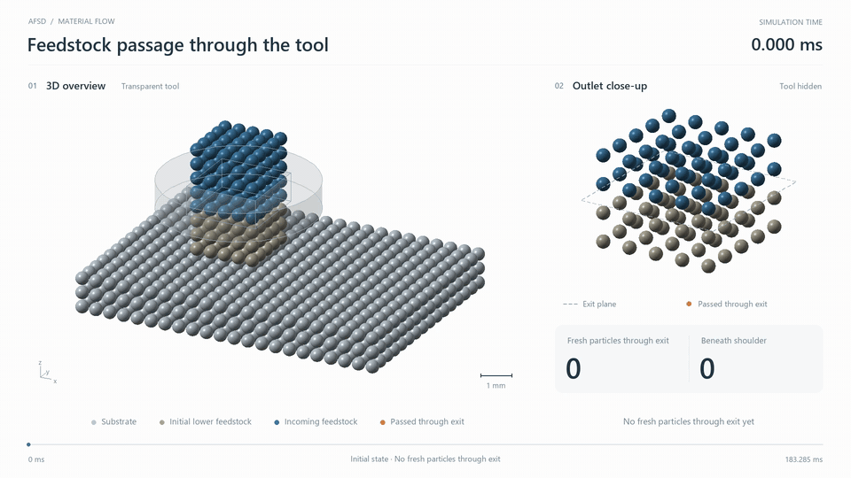

# AFSD Particle Deposition

## 3D feedstock passage

[](docs/media/afsd-feed-through-en.mp4)

**[Open the full English video — 1080p · 40 s](docs/media/afsd-feed-through-en.mp4)** · [Download MP4](https://github.com/guanzhaoyang86-lab/afsd-particle-deposition/raw/refs/heads/main/docs/media/afsd-feed-through-en.mp4)

Recorded simulation states from **0 to 183.285 ms**: **0 → 14 fresh particles through the exit**; **0 beneath the shoulder**. The preview shows outlet passage, with a transparent tool and an outlet close-up. Sustained shoulder deposition has not yet been demonstrated. [Media details](docs/media/manifest.json).

面向增材摩擦搅拌沉积（AFSD）的三维粒子输运与热力耦合研究代码，包含 PySPH 适配层、方孔工具几何、接触与材料响应、事件处理、局部时间步调度和沉积观测。

项目定位为 **ENGINEERING_APPROXIMATE（工程近似）**。工具和送料指令驱动计算，材料运动由求解器计算；穿孔计数与肩下沉积分别统计。当前模型采用热态启动、有限棒料和初始连接界面，尚未证明持续肩下沉积、空间收敛或冶金结合，也不代表论文结果已复现。

## 目录

| 路径 | 内容 |
| --- | --- |
| `src/` | 粒子、材料、接触、热力学及配置模块 |
| `scripts/` | CPU/GPU 适配、求解入口、检查与观测工具 |
| `configs/`、`schemas/` | 参数来源、工况配置及数据契约 |
| `tests/` | 基础测试与研究回归代码 |
| `docs/` | 模型假设、方法契约和历史研究报告 |
| `outputs/` | 保留原路径的历史控制器源码，以及三个必要模型输入 |

## 最小检查

在仓库根目录使用 Python 3.11 执行；以下两组检查只需标准库，不启动物理仿真：

```sh
python -B tests/run_tests.py
python -B -m unittest discover -s tests/review -p test_cpu_local_interval_scheduler_20261015.py
```

第一组检查配置、几何夹具和输出契约；第二组检查局部时间区间细分与步长恢复。通过这些检查不代表物理模型通过验证。`tests/review/` 中其他测试可能依赖 PySPH、历史结果或本机条件，不能直接视为完整可运行测试集。

## 求解依赖与运行范围

物理计算采用固定的 [PySPH](https://github.com/pypr/pysph) 提交：

```text
1cd3dea9cfaac7d9f1bda2a2491ce4b42a31dbe5
```

现有入口会检查 `third_party/PySPH` 的位置、提交和源码状态。仓库以 Git 子模块固定该版本，可用以下命令取得代码：

```sh
git clone --recurse-submodules https://github.com/guanzhaoyang86-lab/afsd-particle-deposition.git
cd afsd-particle-deposition
```

随后按上游说明构建 PySPH，并准备 NumPy 和编译依赖；详见 [第三方来源与许可](third_party/README.md)。公开快照不附带 Python 环境，未验证全新环境安装。历史 Windows 启动器还依赖 `.envs/pysph/python.exe` 等本地约定，需先适配新环境。

初始公开源码快照中的短棒入口使用 **CPU 求解**。仓库另有基于 CuPy 的 GPU 线性代数和历史续跑适配代码；GPU 路径并非全部计算均在显卡上完成，不能仅凭安装 CUDA 就切换求解后端。本页视频展示后续运行历史，不受初始源码快照范围限制。

## 公开快照边界

除首页展示视频外，本仓库不含历史 checkpoint、运行收据、日志、冻结清单和论文 PDF；PySPH 通过子模块引用，其他第三方代码未打包。因此，`outputs/` 中的续跑控制器可用于审阅，但**不能直接恢复本机历史进度**。文档中的结果路径可能指向未公开证据；历史报告不等于本次发布重新执行了相应验证。新算例需另行准备依赖、检查和运行目录。

本次发布副本实际通过上述两组检查，各 19 项，共 38 项。源码文件及三个模型输入保持原始字节；四份文档仅隐去本机用户目录。`PUBLICATION_MANIFEST.json` 记录初始源码快照的来源文件与发布文件 SHA-256；后续首页及展示媒体更新不属于该初始快照，媒体信息另见 [`docs/media/manifest.json`](docs/media/manifest.json)。

本次公开未替项目选择新的开源许可证。PySPH 等上游组件继续遵循各自许可证；依赖来源和署名应保留。
